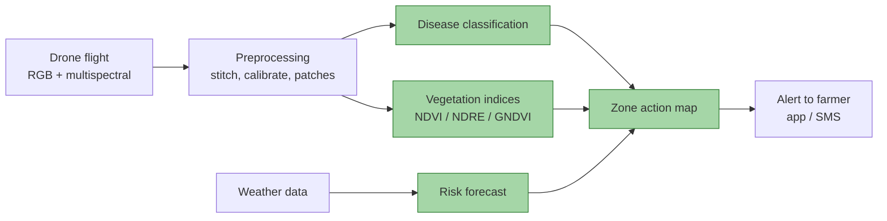
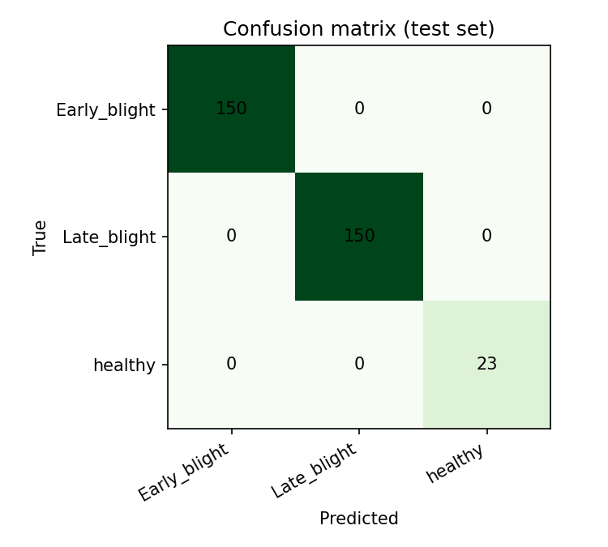
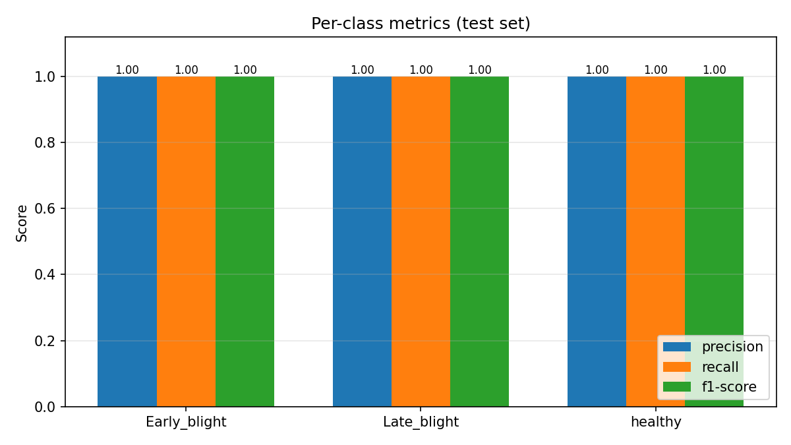
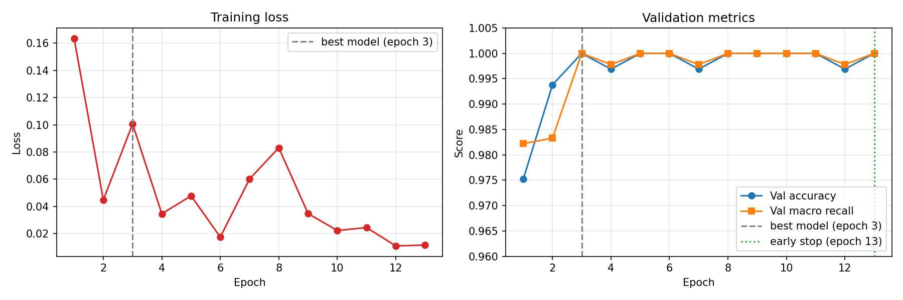
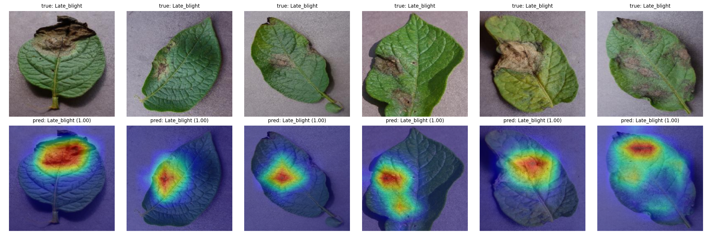
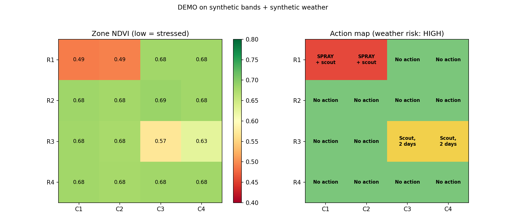

<h1 align="center">🥔 Drone-Based Potato Late Blight Detection</h1>
<p align="center">
  <b>Prototype of the AI stage for a UAV-based disease detection and early warning system</b><br>
  Built for the Hawk Aerospace assessment
</p>

<p align="center">
  <a href="https://colab.research.google.com/github/latashasingh/potato-blight-detection/blob/main/potato_blight_prototype.ipynb">
    
  </a>
  
  
  
</p>

---

## 📌 Overview

Late blight can destroy a large share of a potato crop within days when the weather is cool and humid, and by the time symptoms are visible to the eye the spread has often begun. The full system I designed uses drone imagery (RGB + multispectral) and weather data to **detect infected zones**, **forecast risk for the next 5-7 days** and **recommend zone-wise action**.

This repository is a **working prototype of the core ML stages** of that design, trained and tested on public data. It is **not** the full drone system.

## 🧭 System design and what this prototype covers



🟩 Green = built in this prototype. Other blocks are part of the design but not implemented here.

| Component | Status | Notes |
|---|---|---|
| Disease classification (EfficientNet-B0) | ✅ Built | PlantVillage potato leaves, 3 classes |
| Explainability (Grad-CAM) | ✅ Built | Shows the model looks at lesions |
| Vegetation indices (NDVI / NDRE / GNDVI) | ✅ Demo | Synthetic bands, zone-wise averages |
| Risk forecasting (Random Forest) | ✅ Demo | Synthetic weather, 5-day horizon |
| Zone heatmap + action map | ✅ Demo | Combines NDVI stress with weather risk |
| Orthomosaic stitching, radiometric calibration | ⏳ Future | Needs real drone imagery |
| U-Net segmentation, severity % | ⏳ Future | Needs pixel-level masks |
| LSTM risk model | ⏳ Future | Needs real weather time series |
| MobileNet edge inference | ⏳ Future | Lightweight on-drone model |
| App / SMS alerts | ⏳ Future | Hindi / local language |

## 📊 Results

### 1. Disease classification (test set, 323 images)

| Class | Precision | Recall | F1 | Support |
|---|---|---|---|---|
| Early blight | 1.00 | 1.00 | 1.00 | 150 |
| Late blight | 1.00 | 1.00 | 1.00 | 150 |
| Healthy | 1.00 | 1.00 | 1.00 | 23 |

- **Model:** EfficientNet-B0 with ImageNet weights, early layers frozen
- **Training:** augmentation (flip, rotation, colour jitter), weighted loss for class imbalance, 70/15/15 stratified split
- **Model selection:** best validation macro recall, test set reported once
- **Early stopping:** up to 100 epochs allowed, stopped at epoch 13 (best checkpoint: epoch 3)

> ⚠️ The 100% result is **optimistic**. PlantVillage has many near-duplicate leaf images and the split is random, so similar images appear in train and test. See [Limitations](#-limitations).

<table>
  <tr>
    <td align="center"><b>Confusion matrix (test)</b><br></td>
    <td align="center"><b>Per-class metrics</b><br></td>
  </tr>
  <tr>
    <td colspan="2" align="center"><b>Training curves</b><br></td>
  </tr>
</table>

### 2. Explainability (Grad-CAM)

The heat concentrates on the **lesions**, not on the background or leaf edges, so the classifier is looking at disease symptoms.

<p align="center"></p>

### 3. Risk forecasting (synthetic weather)

A Random Forest predicts whether the next 5 days are high risk from the last 5 days of weather plus 5, 15 and 30-day rolling averages. The decision threshold is tuned on validation data, not on test.

| Version | High-risk recall | High-risk precision | High-risk F1 |
|---|---|---|---|
| Baseline (raw 5-day window) | 0.11 | 0.18 | 0.13 |
| With rolling features + tuned threshold | **0.75** | 0.31 | **0.44** |

Recall is prioritised because a missed infection costs more than a false alarm. Precision is still low, which means many false alarms.

### 4. From detection to action: zone map 

NDVI stress per zone is combined with the weather risk to give a zone-wise recommendation (spray + scout, scout, or no action). In this synthetic field only 2 of 16 zones need spraying.

<p align="center"></p>

## 📁 Repository structure

```
potato-blight-detection/
├── potato_blight_prototype.ipynb     # Full notebook with outputs (run on Colab)
└── upload/
    ├── src/
    │   ├── train.py                  # Classification training, early stopping, test report
    │   ├── gradcam.py                # Grad-CAM visualisation
    │   ├── vegetation_indices.py     # NDVI / NDRE / GNDVI and zone means
    │   └── risk_forecast.py          # Random Forest risk forecast (synthetic weather)
    └── outputs/                      # Result figures
```

## 🚀 How to run

1. Open the notebook in Google Colab using the badge above and select **Runtime → Change runtime type → T4 GPU**.
2. Run the cells from top to bottom. The notebook downloads the PlantVillage potato classes from Kaggle automatically.
3. If the Kaggle download asks for login, add `KAGGLE_USERNAME` and `KAGGLE_KEY` in Colab Secrets.

Train from the command line:

```bash
python src/train.py --data_dir data --model efficientnet_b0 --epochs 100 --patience 10
python src/gradcam.py --data_dir data --model efficientnet_b0
```

## ⚠️ Limitations

- **Lab images, not drone images.** PlantVillage has plain-background leaf photos. Accuracy will drop on real fields; the next step is fine-tuning on labelled drone imagery.
- **Optimistic test accuracy.** The random split contains near-duplicate leaves. A field/plot-wise split is needed for real data.
- **Synthetic data in the demos.** The weather, NDVI bands and field map are synthetic and only demonstrate the pipeline. The "88% of the field spared" figure applies to that synthetic field only and is not a pesticide-saving claim.
- **Low precision in the risk forecast.** Real weather data (IMD / NASA POWER) and field-observed outbreaks are needed.
- **NDVI is not a diagnosis.** A low-NDVI zone can also be water or nutrient stress, so it needs ground or classifier confirmation.

## 🔮 Next steps

1. Fine-tune on labelled drone / field imagery with a plot-wise split
2. U-Net / U-Net++ segmentation for severity %
3. Real weather data and an LSTM risk model
4. MobileNet for on-drone (edge) inference
5. Farmer app and SMS alerts in Hindi / local languages

## 📚 Datasets and references

- PlantVillage dataset (Kaggle: `emmarex/plantdisease`)
- Tan & Le, *EfficientNet: Rethinking Model Scaling for CNNs*, 2019
- Ronneberger et al., *U-Net*, 2015 (planned segmentation stage)

---

<p align="center">Author: <b>Latasha Singh</b></p>
